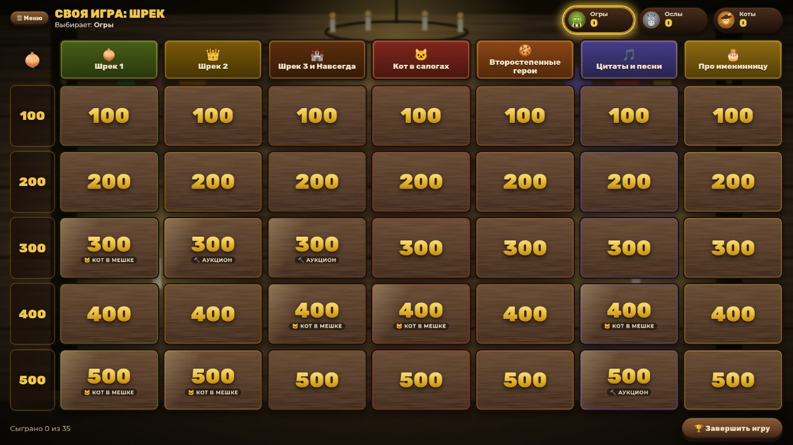
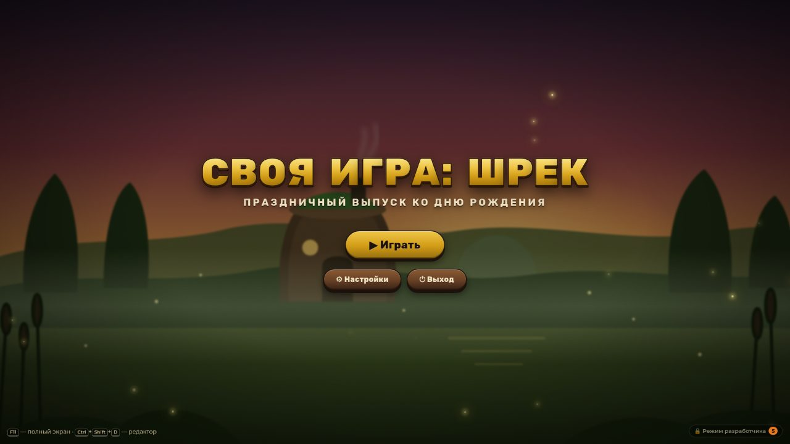
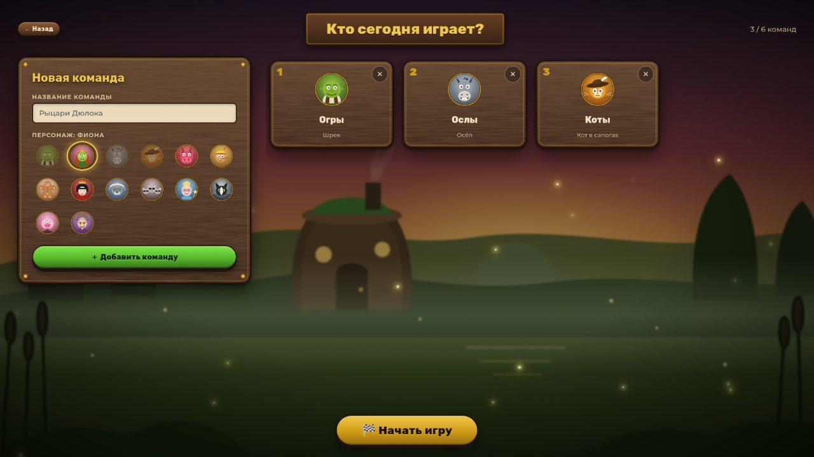
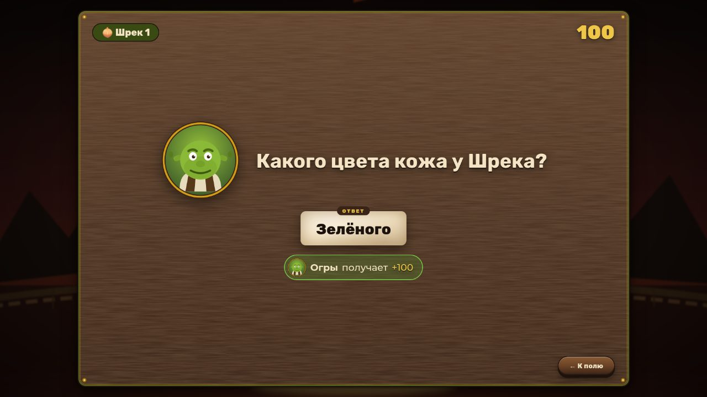
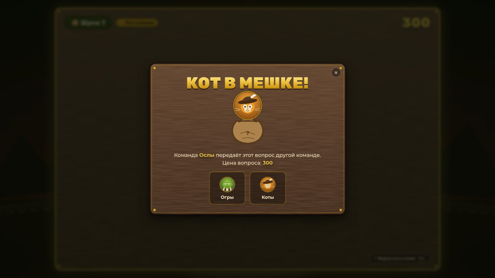
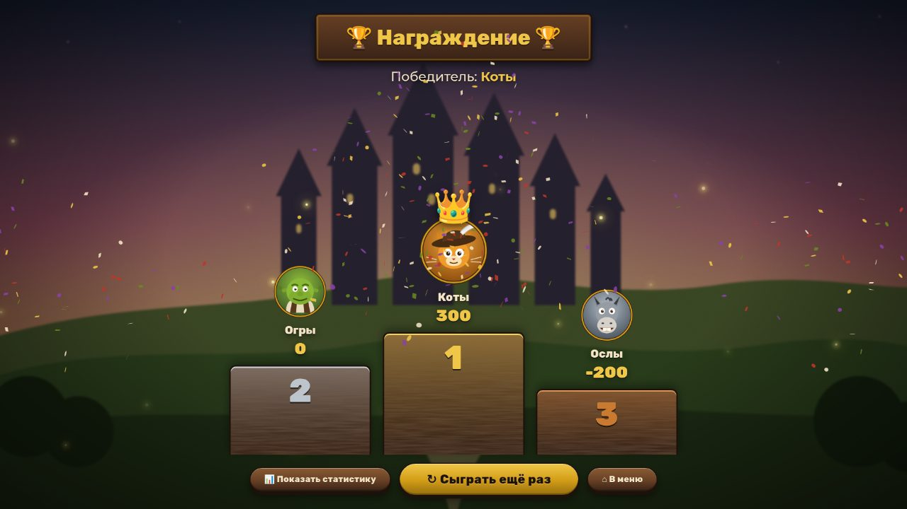
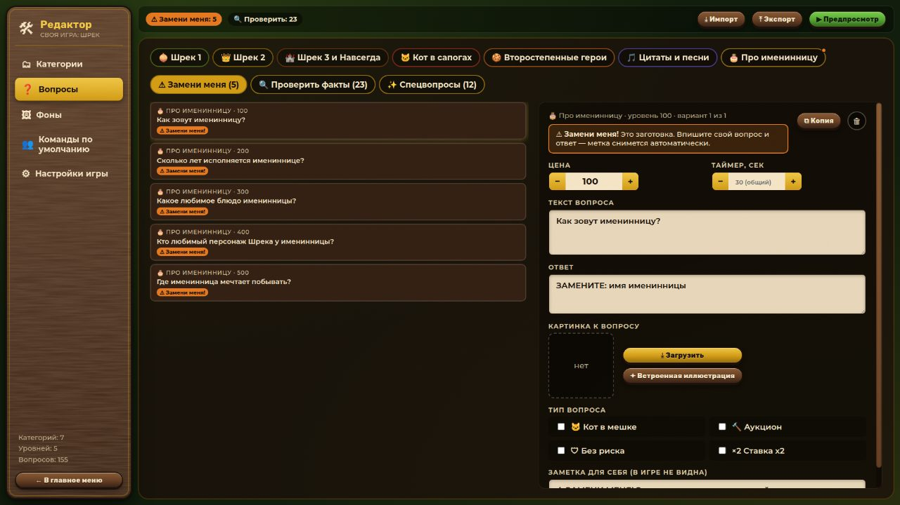

# 🧅 Своя игра: Шрек

Викторина в формате телепередачи «Своя игра» по вселенной Шрека. Сделана к дню рождения. Работает на Windows как обычная программа (`.exe`), интернет для игры не нужен.



| Главное меню | Команды | Вопрос |
|---|---|---|
|  |  |  |
| **Кот в мешке** | **Награждение** | **Редактор** |
|  |  |  |

**Что есть в игре:**
- 7 категорий × 5 уровней (100–500 очков) и 155 вопросов. В каждой клетке несколько вариантов вопроса, в каждой партии берётся случайный.
- От 2 до 6 команд, у каждой свой персонаж: Шрек, Фиона, Осёл, Кот в сапогах, Дракониха, Пряня и другие.
- Специальные вопросы:
  - «Кот в мешке» (6 шт.): вопрос нужно отдать другой команде; бывает со ставкой ×2;
  - «Аукцион» (3 шт.): команды торгуются за право ответить;
  - «Без риска»: за неверный ответ очки не снимаются.
- Таймер, звуки (синтезируются прямо в программе), анимации.
- Финал с пьедесталом, короной, конфетти и статистикой по командам и категориям.
- Режим разработчика: можно поменять всё — категории, вопросы, картинки, фоны, таймеры, цены. Изменения сохраняются автоматически.
- Если программу случайно закрыли, игру можно продолжить с того же места.

---

## 💾 Установка на Windows 11

### 1. Скачайте программу

Готовые файлы лежат в папке [`release/`](release/) этого репозитория. Есть два варианта, выберите любой:

| Файл | Что это | Когда выбирать |
|---|---|---|
| `Shrek-Jeopardy-Setup-1.0.0.exe` | Установщик | Если хотите ярлык на рабочем столе и в меню «Пуск». **Рекомендуется.** |
| `Shrek-Jeopardy-1.0.0-portable.exe` | Портативная версия, одним файлом, без установки | Если нужно запустить с флешки или на чужом компьютере. |

Чтобы скачать: откройте файл на GitHub и нажмите кнопку **Download raw file** (значок ⤓ справа вверху).

### 2. Разрешите запуск (один раз)

У программы нет платной цифровой подписи, поэтому Windows при первом запуске может показать синее окно **«Windows защитила ваш компьютер»** (SmartScreen). Это нормально:

1. Нажмите **«Подробнее»**.
2. Нажмите **«Выполнить в любом случае»**.

Если браузер (Edge или Chrome) предупреждает при скачивании, что файл «скачивают редко», нажмите «…» → **«Сохранить»** → **«Всё равно сохранить»**.

### 3а. Установщик

1. Запустите `Shrek-Jeopardy-Setup-1.0.0.exe`.
2. Установщик на русском. Можно выбрать папку или оставить ту, что предложена. Права администратора не нужны: программа ставится только для текущего пользователя.
3. После установки на рабочем столе появится ярлык **«Своя игра Шрек»** с зелёной головой огра.

Удалить программу можно так: **Параметры → Приложения → Установленные приложения → «Своя игра Шрек» → Удалить**. Ваши вопросы при этом не удаляются.

### 3б. Портативная версия

Просто запустите `Shrek-Jeopardy-1.0.0-portable.exe`. Первый запуск занимает 5–15 секунд, потому что программа распаковывается во временную папку.

### 4. Перед праздником

1. Запустите игру и нажмите **Ctrl + Shift + D**. Откроется редактор.
2. Вверху горит оранжевая метка **«⚠ Замени меня: 5»**. Нажмите на неё и замените пять вопросов-заготовок в категории «Про именинницу» (имя, возраст, любимое блюдо и т.д.). Как только вы измените текст, метка исчезнет сама.
3. По желанию: в «Настройках игры» поменяйте подзаголовок, время на ответ и цены. В «Фонах» можно загрузить свою фотографию.
4. Нажмите **«▶ Предпросмотр»**, чтобы проверить игру, не выходя из редактора.

**Системные требования:** Windows 10 или 11, 64 бит, экран от 1280×720 (рассчитано на 1920×1080), ~350 МБ на диске. Для игры нужно около 0,5–1,5 ГБ оперативной памяти.

---

## 🎮 Как вести игру

Игру ведёт ведущий: он читает вопросы и нажимает кнопки на компьютере. Удобнее всего подключить компьютер к телевизору или проектору.

1. **«Играть»** → добавьте команды (название и персонаж) → **«Начать игру»**.
2. Команда, подсвеченная золотой рамкой, выбирает клетку на поле. Если ход передаётся не так, как нужно, кликните по карточке нужной команды в табло.
3. На экране вопроса:
   - **✔ Верно**: команда получает очки и следующий ход;
   - **✘ Неверно**: очки снимаются (если вопрос не «без риска»), и можно выбрать, какая команда отвечает следующей;
   - **👁 Показать ответ**, или клавиша **Пробел**;
   - **↶ Вернуться к полю**, или **Esc**: закрыть вопрос, не разыгрывая его (если клетку открыли по ошибке).
4. **Кот в мешке 🐱:** активная команда выбирает, какой команде отдать вопрос.
5. **Аукцион 🔨:** каждая команда называет ставку или пасует, отвечает самая высокая ставка. Если все спасовали, вопрос за номинал достаётся активной команде.
6. Поправить счёт вручную: **правый клик** по команде в табло.
7. **🏆 Завершить игру** → награждение → **📊 Статистика** → **↻ Сыграть ещё раз** (команды сохраняются, счёт обнуляется).

### Горячие клавиши

| Клавиша | Действие |
|---|---|
| `Пробел` | Показать ответ |
| `Esc` | Назад / закрыть окно |
| `F11` | Полноэкранный / оконный режим |
| `Ctrl + Shift + D` | Режим разработчика (редактор) |

---

## 🛠 Режим разработчика

Открывается кнопкой «🔒 Режим разработчика» в правом нижнем углу главного меню или клавишами **Ctrl + Shift + D**. В настройках можно задать пароль, чтобы гости случайно не подсмотрели ответы.

| Раздел | Что можно сделать |
|---|---|
| **Категории** | Добавить, удалить, переименовать. Поменять порядок перетаскиванием за ⠿. Выбрать иконку-эмодзи и цвет. Экспорт или импорт отдельной категории. |
| **Вопросы** | Каждый уровень показан строкой с вариантами вопросов. Для вопроса можно задать цену (кнопки − / +), текст, ответ и картинку: свою или встроенную иллюстрацию. Флаги: «Кот в мешке», «Аукцион», «Без риска», «Ставка ×2». Можно задать свой таймер. Добавление и удаление уровней (например, 600). Фильтры «⚠ Замени меня», «🔍 Проверить факты», «✨ Спецвопросы». |
| **Фоны** | 4 встроенных фона и загрузка своих (jpg, png, webp). Для меню, поля, вопроса и финала выбираются отдельные фоны. Ползунки размытия и затемнения, чтобы текст хорошо читался. |
| **Команды по умолчанию** | Команды, которые сразу появятся перед игрой. Список можно оставить пустым. |
| **Настройки игры** | Название, таймеры, звук и громкость, цены уровней, штраф за неверный ответ, пароль, «Сбросить всё». |

Вверху редактора есть кнопки **Экспорт** и **Импорт** всей игры в `.json`. Картинки вшиваются прямо в файл, поэтому игру можно перенести на другой компьютер одним файлом. Индикатор **«Сохранено ✓»** показывает, что изменения записаны на диск.

> **Про вопросы с меткой 🔍.** 23 вопроса помечены флагом «проверить факт» (`"verify": true` в JSON). Это места, где точная формулировка из русского дубляжа или мелкая деталь могут отличаться от того, что я помню. Пройдитесь по фильтру «🔍 Проверить факты»: если всё верно, нажмите «Факт проверен ✓», если нет — поправьте вопрос.

---

## 📁 Где хранятся данные

Все пользовательские данные лежат в папке:

```
%APPDATA%\shrek-jeopardy\
├── gameData.json          ← все вопросы, категории, фоны и настройки
├── gameData.backup.json   ← копия перед последним импортом или сбросом
├── session.json           ← незаконченная партия (для «Продолжить игру»)
├── assets\                ← загруженные картинки и фоны
└── logs\main.log          ← журнал для диагностики
```

Чтобы открыть эту папку, вставьте `%APPDATA%\shrek-jeopardy` в адресную строку Проводника или нажмите «📂 Открыть папку данных» в настройках редактора.

- Дефолтная игра (`src/data/defaultGame.json`) нужна только при первом запуске и при «Сбросить всё».
- При удалении программы эти данные остаются. Чтобы начать с чистого листа, удалите папку.

---

## 🧑‍💻 Сборка из исходников

Понадобятся [Node.js](https://nodejs.org/) 20 или новее и npm.

```bash
npm install          # зависимости
npm run dev          # режим разработки с горячей перезагрузкой
npm run check        # проверка типов TypeScript и валидация контента
npm run build:win    # сборка Windows: dist/*.exe (portable + установщик NSIS)
npm run test:e2e     # сквозной тест всех сценариев (Playwright + Electron)
```

- `npm run build:win` работает и на Windows, и на Linux/macOS: деинсталлятор NSIS извлекается JS-средствами electron-builder, Wine не нужен (см. `scripts/build-win.mjs`).
- Иконка пересобирается командой `npm run icon` из `build/icon.svg`.
- Контент по умолчанию генерируется командой `npm run content` из `scripts/build-default-game.mjs` в `src/data/defaultGame.json`.
- На Linux без дисплея тест запускается так: `xvfb-run -a npm run test:e2e`. Чтобы проверить уже упакованное приложение, передайте путь к нему: `E2E_EXE=dist/linux-unpacked/shrek-jeopardy`.

### Стек

Electron 44 · React 18 · TypeScript · Vite · Framer Motion · Zustand · Howler.js · dnd-kit · canvas-confetti · electron-builder. Шрифты Rubik и Montserrat встроены локально.

### Структура

```
electron/     main.ts (окно, протокол asset://, блокировка сети, логи), storage.ts (файлы), preload.ts (мост)
src/
  modes/GameMode/   StartScreen, TeamSetup, Board, QuestionScreen, CatInBagModal, AuctionModal, Finale
  modes/DevMode/    DevMode, CategoriesEditor, QuestionsEditor, QuestionForm, BackgroundsEditor, TeamsEditor, SettingsEditor
  components/       art.tsx (SVG-персонажи и иллюстрации), ui.tsx (фон, модалки, логотип), ScoreBoard, Timer
  store/            content (вопросы и автосохранение), session (партия), ui (экраны)
  audio/            synth.ts (синтез звуков через Web Audio), sounds.ts (Howler)
  data/             defaultGame.json
public/backgrounds/ 4 SVG-фона
scripts/            генерация контента, валидатор, иконка, сборка Windows
tests/e2e.mjs       сквозной тест
```

### Безопасность

Включены `contextIsolation`, `sandbox` и `nodeIntegration: false`. Renderer общается с системой только через типизированный мост `window.api`. Действует CSP. Любые сетевые запросы блокируются в main-процессе. Картинки пользователя отдаются через протокол `asset://`, у которого есть защита от выхода за пределы папки `assets`.

---

## ❓ Если что-то не так

| Проблема | Решение |
|---|---|
| Не запускается, «Windows защитила ваш компьютер» | «Подробнее» → «Выполнить в любом случае». |
| Антивирус ругается на portable-версию | Неподписанные portable-exe иногда дают ложные срабатывания. Используйте установщик или добавьте файл в исключения. |
| Нет звука | Проверьте «⚙ Настройки» в главном меню (переключатель звука и громкость) и громкость Windows. |
| Окно маленькое или не на весь экран | Нажмите F11. |
| Игра открылась «пустой» или с ошибкой | Пришлите файл `%APPDATA%\shrek-jeopardy\logs\main.log`. |
| Испортили вопросы | Редактор → Настройки → «Сбросить всё». Прошлая версия сохранится в `gameData.backup.json`. |

---

Фанатский некоммерческий проект для домашнего праздника. «Шрек» и все персонажи принадлежат DreamWorks Animation. В игре нет кадров из фильмов: все персонажи нарисованы как стилизованные векторные символы.
